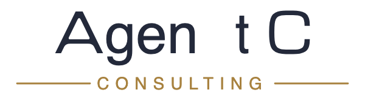

<picture>
  <source media="(prefers-color-scheme: dark)" srcset="https://raw.githubusercontent.com/AgentC-Consulting/.github/main/brand/wordmark-dark.png">
  
</picture>

# AgentC Consulting

**We build native apps and AI-built systems with permanence** — real software,
signed with our name on it. The best way to show you is to hand you some.

## Free apps, free for life

No accounts. No telemetry. No trials. Download and go.

| | | |
|---|---|---|
| 🌀 | **[HeatPilot](https://github.com/AgentC-Consulting/heatpilot)** | Menu-bar fan control for Apple Silicon. A cooler curve, a Full Blast button, one click back to Apple's defaults. [Download](https://github.com/AgentC-Consulting/heatpilot/releases/latest) |
| 🎙️ | **[Scribe](https://github.com/AgentC-Consulting/scribe-app)** | On-device dictation and meeting transcription for macOS. Press a hotkey, talk, and your words land at your cursor — no cloud, ever. [Download](https://github.com/AgentC-Consulting/scribe-app/releases/latest) |

Every release is signed with Apple Developer ID, notarized, and ships with
GPG-signed checksums. Found a bug or want a feature? Open an issue on the
app's repo — we read everything.

## The part where we mention we do this for a living

Apps like these are what we build for clients: native macOS software, custom
business systems, and AI-assisted development done by people who ship.

**[agentc.consulting](https://agentc.consulting)** · agent_c@agentc.consulting
