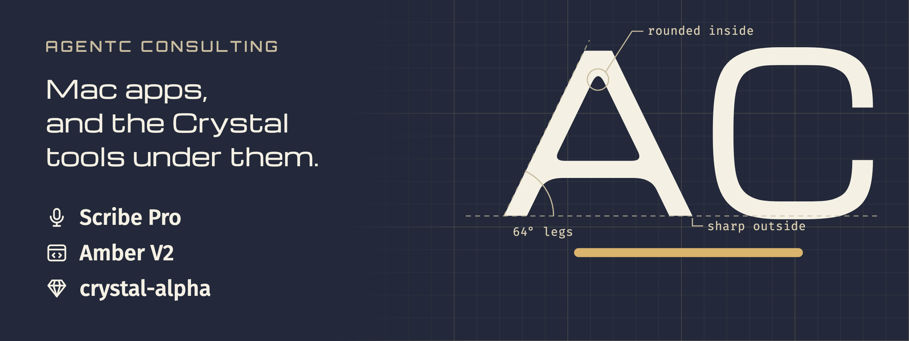

<a href="https://agentc.consulting/?ref=github-org"><picture><source media="(max-width: 600px)" srcset="https://raw.githubusercontent.com/AgentC-Consulting/.github/main/brand/banner_phone.png"></picture></a>

## Your coding agent says it is done. What changed?

You say "fix the failing sign-in test" out loud, and keep working. 
Your coding agent starts on it. 
When it says it is done, can you trust what it did?

 **Scribe Pro opens the result with its proof**, so you check the change before you trust it.

AgentC makes Scribe and works on every tool on this page.

### For your Mac

 **[Scribe Pro](https://agentc.consulting/scribe/pro?ref=github-org)**: dictate a request, watch Codex or Claude Code work on it, then open the result with its proof.

 **[Scribe Pro is half price until 1.0](https://agentc.consulting/scribe/pro?ref=github-org)**: every update until 1.0, then 12 more months.

 **[Scribe Free](https://agentc.consulting/portfolio/scribe?ref=github-org)**: hold a hotkey, talk, and your words appear at your cursor in any app. It runs on your Mac, with no account.

 Both need an Apple silicon Mac with macOS 26 or later.

### For Crystal developers

 **[Amber V2](https://amberframework.org)**: build a Crystal web app with the 2.0 beta; start with the [to-do app tutorial](https://github.com/AgentC-Consulting/amber-crystal-todo-tutorial).

 **[crystal-alpha](https://github.com/crimson-knight/crystal/releases)**: our Crystal compiler fork, working toward faster builds; incremental compilation ships now.

 **[Agent-Enhanced Development conventions](https://github.com/AgentC-Consulting/aed-conventions)**: how we write code that people and coding agents maintain together.

### Try one thing today

 **[Install Scribe Free](https://agentc.consulting/portfolio/scribe?ref=github-org)** → hold the hotkey → say your next commit message → it appears at your cursor.

 Want software like this built for your business? **[agentc.consulting](https://agentc.consulting/?ref=github-org)**
